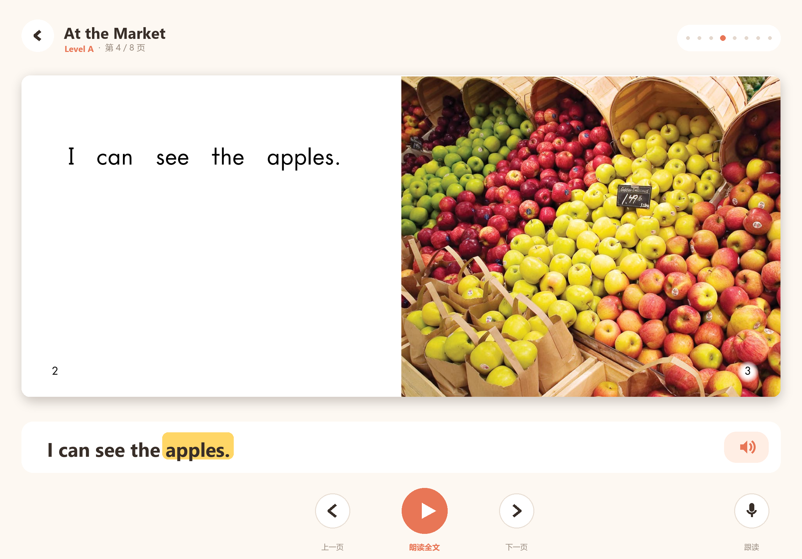
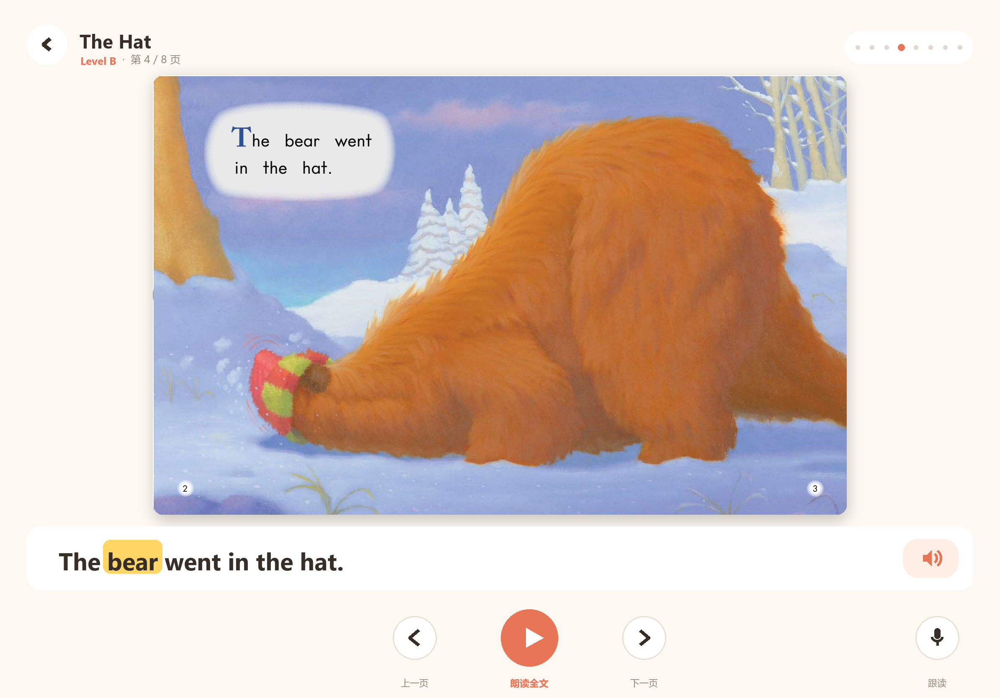
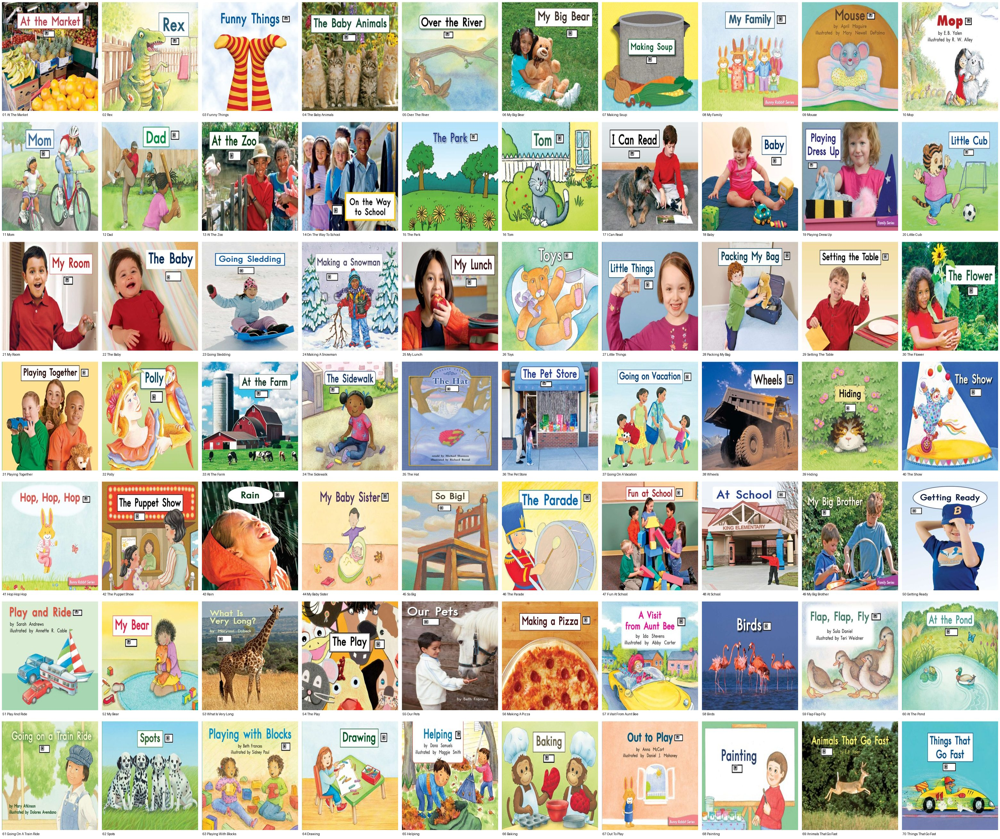
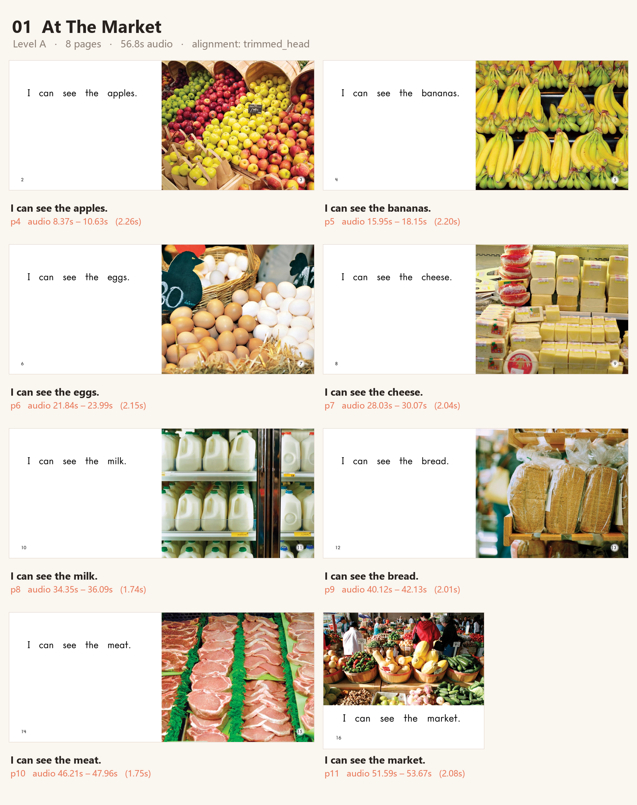
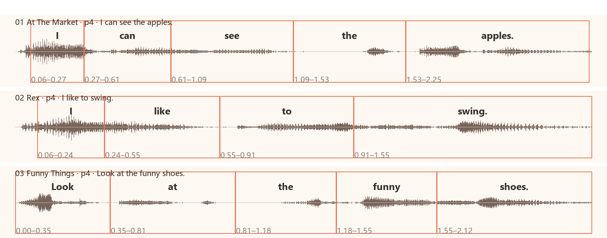

# GK 有声绘本 iPad App —— 实施方案

> 面向 4–7 岁、英语零基础的儿童，用现有 **70 本 GK 有声绘本 PDF + 70 段男声录音**做成一台 iPad 上的本地离线分级阅读 App。
> 本文所有数字都来自对 `E:\apple app` 里真实素材的实测，不是估算。

---

## 一、素材实测结果

| 项目 | 实测值 | 结论 |
|---|---|---|
| 绘本 PDF | 70 个，125.0 MB | 完整，编号 01–70 与音频完全对应 |
| 音频 | 70 个，45.3 MB，共 **63.5 分钟** | 69 个 `.wma` + 1 个 `.mp3`（09 Mouse） |
| 音频规格 | 96 kbps / 立体声 / 单本 40–99 秒 | 语音为主，可压到 48–64 kbps 单声道 |
| 每本页数 | 69 本 11 页；**35 The Hat 是 15 页** | 结构统一 |
| 页面构成 | p1 封面跨页 → p2 版权页 → p3 书名页 → **p4–p11 正文 8 个跨页** | 正文固定在 4–11 页，可脚本化 |
| 正文文字 | **560 句**，458 个词形，约 92–95% 可自动提取 | 有文字层，省掉大量手抄 |
| 文字坐标 | 每个字都有精确包围盒（已逐词验证） | **能做逐词高亮 / 点读** |
| 分级 | A 级 44 本、B 级 14 本、C 级 12 本 | 天然三级书架 |
| 版式 | ①科普类：左白页文字 + 右整页照片<br>②经典故事类：整幅插画 + 白色气泡文字 | 两种版式，一套逻辑可覆盖 |

素材来源是 **Heinemann 的 LLI（Leveled Literacy Intervention）GK 级别**分级读物，A/B/C 是 F&P 分级的最低三档。

### 需要处理的问题（已定位，都有对策）
1. **WMA 格式 iPad 放不了** —— AVFoundation 不支持 WMA，必须转码成 AAC/m4a。这是最硬的卡点，不是可选项。**已经解决**：用 Windows 自带的媒体转码引擎转，70 本全部成功。
2. **书名不完全一致**：37 / 43 / 58 三本的 PDF 与音频标题有差异（例：`Going On A Vacation` vs `Going On Vacation`），另有 41 / 59 只是逗号差异。→ 一律按**编号**对齐，不按标题。
3. **印前垃圾**：每页脚注有 `LLI_xxx.indd 2-3 1/3/08 3:13:09 PM`，个别页混入美术批注（如 45 号页有 `OVERALL: interior art will have a background of blue sky…`）。→ 已写规则过滤，剩余约 5% 人工过一遍。
4. **引号乱码**：受字体编码影响，`"` `"` 提取成 `��`。→ 只影响标点，用正则规范化即可。
5. **封面上烧了一个播放按钮图标** —— 这些 PDF 本身是交互版。裁封面缩略图时避开，或直接盖掉。

### 版权（重要）
正文与配音版权属 Heinemann。**家庭自用没问题，但不能上架 App Store**（会被拒/下架）。这一条直接影响下面的"怎么装到 iPad"的选型——只能自签安装或本地网页。

---

## 二、最大的工程约束：iOS App 必须有 Mac 才能编译

Xcode 只跑在 macOS 上。所以在 Windows 上做 iPad App，只有三条路：

| | 路线 | 你需要准备 | 首次上机 | 有效期 | 体验 | 主要风险 |
|---|---|---|---|---|---|---|
| **A** | 原生 SwiftUI + Xcode | 一台 Mac（借/租云 Mac 都行）+ 免费或付费开发者账号 | 约 1 天 | 免费账号 7 天；付费账号（￥688/年）1 年 | ★★★★★ | 需要 Mac |
| **B** | Web 内核 + Capacitor 打包，用 GitHub Actions 的 macOS 机器云端出包，SideStore 装到 iPad | 免费 Apple ID | 约半天 | 7 天，SideStore 可自动续签 | ★★★★☆ | 每 7 天要续签一次（可自动化） |
| **C** | 纯网页 PWA，局域网起个本地服务，iPad Safari「添加到主屏幕」 | 无 | **10 分钟** | 永久 | ★★★☆☆ | 电脑得开着；离线缓存 100MB+ 有被系统清理的风险 |

**我的建议：先做 C 的 Web 版当产品内核，再按你的条件套 A 或 B 的壳。**
理由：三条路的 **UI、交互、素材、数据格式 100% 相同**，只有外壳不同。Web 内核今天就能在 iPad 上看到效果、随时改，后面换壳零返工。反过来如果直接进 Xcode，改一次 UI 就要重编译重装。

一个不折腾签名也不开电脑的野路子（可行但偏 hacky）：把整个 `library/` 放进 iPad「文件」App，用带内置本地服务器的 App（如 Documents）打开网页版。等 Web 版做出来后可以试。

### 网页版（PWA）到底差在哪 —— 8 条实打实的损失

| # | 损失 | 具体表现 |
|---|---|---|
| 1 | **缓存会被系统清** | iOS 有存储回收策略。100 MB+ 的绘本库一旦被清，孩子打开就是白屏、要重新下。**这是最致命的一条。** |
| 2 | **必须有台机器一直开着** | 要么家里电脑不关机（休眠、断电就断），要么放到公网——那就不算"本地"了，还得防孩子点出去。 |
| 3 | **音频体验打折** | Safari 受静音开关影响、锁屏或切后台会掐断播放、切音频有可感延迟；原生 AVFoundation 没这些毛病。 |
| 4 | **锁不了横屏** | iOS 的 PWA 不能强制横屏，家长把 iPad 竖过来版式就乱；原生在 Info.plist 里写一行就锁死。 |
| 5 | **挡不住退出** | 上滑回桌面、四指切换、下拉通知中心，网页一个都拦不住；原生可以走引导式访问、禁用多任务。 |
| 6 | **全屏不彻底** | 状态栏、底部横条还在，沉浸感差一截。 |
| 7 | **内存上限更紧** | Safari 的图片内存预算比原生小，560 张大图列表滚动容易崩。 |
| 8 | **录音对比不顺** | `getUserMedia` 每次要授权、不能后台；原生 `AVAudioRecorder` 授权一次长期可用。 |

**关键一点：路线 B 就是"网页内核 + Capacitor 壳"。** 壳要干的活，恰好把这 8 条一条条补回来——素材打进 App 包（不会被清）、AVAudioPlayer 原生播放、Info.plist 锁横屏、真全屏、引导式访问。

所以结论不是"二选一"，而是：

> **先做网页版 = 先完成 80% 的工作；后面套壳 = 加一层 WKWebView，业务代码零改动。**

"先做网页版"和"最终要个真 App"并不冲突，网页版是中间的必经一站。

---

## 三、内容流水线（离线跑一次，Python）

产出物：一个 `library/` 目录，约 **110–120 MB**（可压到 80 MB）。App 只读它，不需要网络。

```
library/
├── manifest.json              # 书架索引：70 本，标题/级别/页数/音量
├── covers/01.webp …70.webp    # 封面缩略图 300×255
├── books/01/
│   ├── p04.webp … p11.webp    # 正文 8 张，长边 1600px（实测每张 150–180 KB）
│   └── book.json              # 每页文字、词框、音频起止时间
└── audio/01.m4a … 70.m4a      # AAC 64 kbps 单声道，约 30 MB
```

`book.json` 的形态（坐标归一化到 0–1，跟分辨率解耦）：

```json
{
  "id": 1, "title": "At the Market", "level": "A", "genre": "nonfiction",
  "audio": "audio/01.m4a", "duration": 56.8,
  "pages": [{
    "image": "books/01/p04.webp",
    "text": "I can see the apples.",
    "audio": [3.2, 9.6],
    "words": ["I", "can", "see", "the", "apples."],
    "boxes": [[0.083,0.775,0.090,0.830], [0.121,0.775,0.166,0.810], "…"],
    "wordTimes": [[3.20,3.48], [3.62,3.96]]
  }]
}
```

### 五道工序
1. **渲染页面图** —— `pypdfium2` 按长边 1600px 出图，JPEG→WebP。已实测：1600×679、178 KB，文字清晰可读。
2. **提取文字与词框** —— `pypdf` 取文字层 + `pypdfium2` 取逐字坐标，空白字符断词。已实测能正确切出 `I / can / see / the / apples.` 和气泡里的 `The bear went / in the hat.`。
3. **转码音频** —— **实测不用装 ffmpeg**：Windows 自带的媒体转码引擎（Media Foundation）就能把 WMA 直接转成 m4a（AAC），单本约 2 秒，**70/70 全部成功**。这比装 ffmpeg 更省事，也不用担心 N 版 Windows 之外的依赖问题。
4. **切分句子时间轴** —— 已被实测验证过，**不需要 ASR 也能做**：
   - 这 70 段录音的结构高度规律：**一句话 → 静音 3.5 秒左右 → 下一句**。全库静音间隔中位数 **3.53 秒**，单句平均 **1.74 秒**。
   - 70 本里有 **55 本正好切出 9 段、2 本切出 8 段**（8 句正文 + 1 段片头/片尾）→ **81% 可以直接自动对齐**。
   - 剩下 13 本（都是长一些的 B/C 级书，10–24 段）需要额外处理：优先用片段时长模式判定，仍不行才上 `faster-whisper` 强制对齐（63 分钟音频，CPU 约 10–20 分钟），最后的兜底才是手工标。
5. **自检** —— 校验脚本：70 本齐全、每本 8 页、每页有图有字有时间轴、音频时长对得上、`manifest.json` 可解析。任何一项不过就报错，不静默跳过。

> 这一步做完，你就永久拥有了一份"结构化"的绘本库。以后加书、换壳、做别的功能都不用再碰 PDF。

### 顺带发现：录音本身就在等孩子跟读
每句话后有 **3.5 秒左右的空档**。这不是坏数据，而是**现成的跟读节拍**——App 可以在这段静音里放一个温柔的"轮到你啦"提示，孩子跟读，自然形成"听一句、说一句"的节奏，完全不需要额外做计时器。这个空档是 P1「跟读」功能最好的基础。

---

## 四、App 长什么样

阅读器效果图（用**真实素材**渲染，不是画稿）：左为科普版式，右为经典故事版式。





70 本封面（已按编号 01–70 全部抽出来，直接可用作书架）：



### 页面结构（4 个屏就够）
1. **书架** —— 封面网格，按 A/B/C 三个标签页分组；已读打勾、星级、继续阅读大按钮。
2. **阅读器**（核心）—— 横屏，整页绘本图居中铺满，句子高亮框叠在上面。
   - ▶ 整本朗读：自动翻页，翻页有轻微动效 + 轻音效
   - 点任意一句 → 只读这一句并高亮
   - 左右滑动 = 手动翻页；双击 = 放大
3. **跟读**（P1）—— 点麦克风录自己的声音，和原音 A/B 对比播放。
4. **家长区** —— 连点三次 + 一道算术题才进；设置语速、是否自动翻页、清空进度、导出录音。

### 功能优先级
| | 功能 | 说明 |
|---|---|---|
| **P0** | 书架 + 阅读器 + 整本朗读 + 自动翻页 + 单句重播 | 无它不成产品，这是第一版必须有的 |
| **P1** | 逐词高亮（卡拉OK）/ 跟读录音 + A/B 对比 + L1/L2 反馈 / 生词本 / 语速调节 | 逐词高亮要额外跑一次 whisper 拿逐词时间戳；录音打分的分层见下一节 |
| **P2** | 听音选图、看图选句、闯关奖励、家长周报 | 有 P0 的数据以后加，不难 |

**明确不做**：账号、云同步、社交、排行榜。默认零联网——录音不离开设备是底层原则。

### 录音打分能做到什么程度

**能做，但"打分"必须拆成三层——三层的工程成本和可信度差 100 倍。**

| 层级 | 能测什么 | 能不能全离线 | 工作量 | 建议 |
|---|---|---|---|---|
| **L1 行为层** | 有没有开口、说了多久、音量和原音比 | ✅ 纯音频能量分析，完全离线 | 约 1 天 | **必做** |
| **L2 完整性** | 逐词读到了没：漏了哪个词、多读了哪个词、顺序对不对 | ✅ 设备端 ASR 转写后和原句做词级比对 | 3–5 天 | **推荐**（第一版的"打分"就做这个） |
| **L3 发音质量** | 音素级准确度，给出 0–100 分 | ❌ 要么上云（讯飞 / Azure），要么自己训 GOP 模型塞进 Core ML（2–4 周起） | 2 周~2 个月 | **第一版不做** |

#### 为什么第一版不建议给数字分

- **儿童语音识别本身就是瓶颈**。4–7 岁孩子 + 非母语发音，ASR 的识别错误率比成人高得多，一个不准的分数比没有分数更糟。
- **研究结论也不支持**。有研究拿 190 段韩国小学生朗读音频比对人工评分，发现 Azure 的音素级准确度分与人工判断只是"中等相关"——也就是说，数字分并不能真的代表"读得好不好"。
- **对 6 岁孩子是负反馈**。屏幕上跳出一个"58 分"，孩子看不懂为什么，家长也没法解释，还容易打击兴趣。

#### 我推荐的反馈形式（L1 + L2，全离线，不用联网）

我们手上正好有**每个词的坐标**，所以"漏读了哪个词"可以直接在绘本页面上把那几个词点亮成灰色——比任何数字都直观：

| 情况 | App 的反应 |
|---|---|
| 读完整、词都到了 | 星星 + 原音再放一遍 + "太棒了！" |
| 漏了 1–2 个词 | 把那几个词轻轻闪一下，配音念那一个词，再让孩子重读那一句 |
| 明显没读 / 声音太小 | "再大声一点点～"（L1 就能判断） |
| 读错词序 | 不扣分，只把正确顺序重放一遍 |

**核心原则：只提示、不惩罚。** 游戏化靠"集星星、连续读对几天"，不靠"扣分"。

#### 什么时候才需要 L3（真·发音打分）

只有一种情况值得上：你希望孩子纠正**具体某个音**（比如 th、v、r）。这只能靠音素级评测，而音素级评测目前没有靠谱的离线方案。

两个可选的云端服务（都要联网、都要账号）：

| 服务 | 能力 | 大概成本 | 备注 |
|---|---|---|---|
| [讯飞语音评测](https://suzhou.xfyun.cn:443/services/ise) | 英文单词/句子/篇章，带 `slack` 松紧度参数（可以调宽松，对小孩友好） | 约 54–60 元/万次；新用户实名后有免费包 | 国内访问快，有 iOS SDK |
| [Azure 发音评估](https://docs.azure.cn/pt-br/ai-services/speech-service/pronunciation-assessment-tool) | 朗读、说话、游戏三种模式，能到音素级 | 免费层每月 5 小时，超出按秒计 | 文档最完整，但国内访问要绕 |

算笔账：一个孩子每天读 10 句，一年约 3650 次，讯飞那边**一年 20 块钱左右**。所以不是钱的问题——问题是**一开这个功能，"全离线、录音不出设备"这个卖点就没了**，而且儿童语音上传涉及合规。

**结论：做成一个默认关闭的"精准评分（需联网）"开关。** 关闭时 100% 离线可用；打开时明确告知会上传录音。这样既保留了本地化产品的优势，又给想较真的家长留了口子。

#### 实现时的几个坑

1. **录音权限**：原生要 `NSMicrophoneUsageDescription`；Web 内核（Capacitor）里还要实现 `WKUIDelegate` 的 `requestMediaCapturePermission`，否则 WKWebView 里 `getUserMedia` 直接失败——这个坑很多人踩。
2. **录音窗口不用自己算**：每句后面本来就有 **3.5 秒空档**，直接拿这段当录音区间，天然对齐。
3. **设备端 ASR 怎么选**：
   - **iOS 26 起**用新的 `SpeechAnalyzer` / `SpeechTranscriber`（全设备端、Swift-only，官方已取代 `SFSpeechRecognizer`）。需要 iOS 26 + 已安装对应语言的语音资源，且要检查硬件是否支持。
   - **老系统**退回 `SFSpeechRecognizer` + `requiresOnDeviceRecognition = true`（iOS 13+）。
   - 想要更可控的，可以塞 `whisper.cpp` 的 Core ML 模型（Metal/ANE 都支持），但要自己扛模型体积和识别精度。
4. **A/B 对比播放是刚需**：孩子录完要能一键"我的 / 老师的"来回切。这个比分数有用得多。
5. **录音存哪儿**：只存 App 沙盒本地，家长区放"一键清空录音"，别上传、别进 iCloud 备份（`isExcludedFromBackup`）。

---


### 点读：点哪儿、发什么音

点读不是一个功能，是**四种点击**，成本差很多：

| 点哪里 | 发生什么 | 依赖什么 | 状态 |
|---|---|---|---|
| 点页面空白 | 读这一页（这一页就是一句话） | 句级音频 + 句子框 | ✅ M0 已有 |
| 点句子 | 重播这句，词随读逐一亮 | 句级音频 + 词框 + **词级时间戳** | ⏳ 只差时间戳 |
| **点单个单词** | **只读这一个词** | 词级时间戳（从原音切） | ⏳ 同上 |
| 长按单词 | 弹出中文释义 + 再读一次 | 455 词的迷你词典 | ⏳ 词典待做 |

#### 关键决策：单词音从**原音里切**，不用 TTS

- **做法**：播放器 seek 到 `[t0, t1]`，播完自动停。不新增任何音频文件，体积零成本。
- **为什么不用 TTS**：TTS 和绘本配音是两个不同的人，孩子听两套音会混乱；而且 TTS 读孤立单词时重音经常不对（比如 `the` / `a` 的弱读）。
- **代价**：需要一次性的**强制对齐**，把 3380 个词的位置标出来。

#### 数据量（已从 `library/` 统计出来）

| 指标 | 数值 |
|---|---|
| 句子总数 | **560** |
| 朗读的词次 | **3380** |
| 不同的词形 | **455** |
| 每本不同的词 | 最少 10、中位 13、最多 62 |
| 只出现一次的词 | 218 |

455 个词意味着：**一本手校对过的小词典是完全做得到的**，比接通用词典靠谱得多。而且高频词就是 GK 的 sight words——`the` 出现 297 次、`is` 161 次、`can` 144 次、`look` 96 次，**前 20 个词占了全部朗读量的四成**。这天然就是一个"高频词优先"的学习路径。

### 对标：新东方小书童 / 洪恩的功能基线

小书童的核心是**「五步学习法」**：音频导读 → 单词卡 → 听读 → 跟读（逐句打分）→ 练习题；再叠加长按单词翻译、蓝思测评、积分商城/勋章、磨耳朵泛听、阅读打卡。

| 功能 | 新东方小书童 | 洪恩 | 我们 |
|---|---|---|---|
| 五步学习法 | 导读→单词卡→听读→跟读→练习 | 类似 | **听读→点读→跟读→小测**（去掉导读，家长 30 秒就能讲） |
| 点读 | 长按单词翻译 | 逐词高亮、拖拽拼读 | **单词级点读 + 长按释义** |
| 跟读打分 | 语音评测 | 智能语音纠错 | L1/L2 离线（见上节），L3 云端可选 |
| 单词卡 | ✅ | ✅ | ✅ 455 词，按出现顺序生成 |
| 练习题 | ✅ 自研题库 | ✅ | ✅ 生成式：听音选图、看图选句（不用版权题库） |
| 分级测评 | 蓝思测评 | OPERA | ❌ 不做——只有 70 本，不需要测 |
| 书城 | 2000–3000 册 | 1000+ | ❌ 自带你自己的 70 本 |
| 积分商城/勋章 | ✅ | ✅ | ✅ 只做星星 + 徽章，**不做商城**（不做虚拟经济） |
| 阅读打卡 | ✅ | ✅ | ✅ 连续天数 |
| 磨耳朵（泛听） | ✅ | ✅ | ✅ 锁屏连播整个级别 |
| 家长报告 | ✅ | ✅ 时长管控 | ✅ 周报 + 时长 |

**该抄的**：五步法的结构（尤其是"单词卡预习 + 跟读 + 小测"这个闭环）、长按翻译、逐句跟读。
**不该抄的**：书城、蓝思测评、积分商城、社交排行——我们只有 70 本，抄这些只会让 App 变臃肿，反而把"专注读完这 70 本"的定位稀释掉。

---

### 儿童 iPad App 的交互红线
- 可点区域 **≥ 72pt**，文字最小 20pt，图标 + 文字双编码
- 锁定横屏；禁止下滑退出；没有需要读懂的设置项出现在主流程
- 浅色高对比，不做深色模式（4–7 岁不需要，反而添乱）
- 播放时控制条 2 秒后淡出，画面只剩绘本
- 一次点击只做一件事，绝不出现长按/双击/滑动这类隐藏手势作为**唯一**入口
- 语音提示可以代替文字说明（"点这里读给我听"）

---

## 五、里程碑与工时

| 阶段 | 内容 | 产出 | 工时 |
|---|---|---|---|
| **M0** | 素材流水线跑通 70 本 | `library/` 完整可用 | ✅ 已完成（约 1 小时） |
| **M1** | Web 版阅读器 P0 | 电脑浏览器里能完整读完一本书 | 2–3 天 |
| **M2** | 上 iPad（按 A / B / C 选一条） | 真机可用 | 0.5–1 天 |
| **M3** | P1：逐词高亮 + 跟读 + 生词 | 学习闭环 | 3–4 天 |
| **M4** | 打磨：动效、音效、家长区、验收 | 可交付 | 2 天 |

合计约 **9–12 个工作日**；如果只做 P0 + 上机，**4–5 天**就能让孩子用上。其中 M0 已经做完了。

---

## 六、风险与对策

| 风险 | 影响 | 对策 |
|---|---|---|
| 13 本长书的句子切分不准 | 那几本自动翻页会错位 | 片段时长模式判定 → whisper 强制对齐 → 手工兜底，逐级降级；已把范围缩小到 13/70 |
| 儿童语音识别不准 | 跟读反馈会误判"漏词"，打击孩子 | 判定放宽（只认明显漏词）、永远给"再试一次"的出口、L3 音素分默认关闭 |
| iPad 存储/缓存被清 | PWA 路线要重新下载 100 MB+ | 选 A/B 路线（素材打包进 App 内，不会被清） |
| 免费签名 7 天过期 | 每隔一周要重装 | SideStore 自动续签；或花 ￥688/年买开发者账号 |
| 孩子误触退出/乱改设置 | 用不了 | 家长锁 + 全屏 + 关键手势加确认 |
| 素材版权 | 不能上架 | 只做自签安装/本地网页，绝不上架、不分发 |
| 约 700 个文件的管理 | 命名一乱就全废 | 全部走 `manifest.json` 单一索引，文件名只做 `01`–`70` |

---

## 七、验收标准

- [ ] 70 本书全部能打开，标题/级别与封面一致
- [ ] 每本书 8 页全部有图、有字、能读
- [ ] 整本朗读能自动翻页，误差 < 0.5 秒
- [ ] 断网状态下功能 100% 可用（飞行模式验收）
- [ ] 冷启动到可点击 < 2 秒；翻页 < 300 ms
- [ ] 孩子独立操作 3 分钟，不求助、不误触退出

---

## 八、已经定下来的事

- ✅ **路线**：B —— 没有 Mac，走「云端 macOS 构建 + SideStore 安装」。网页内核先跑通，再套 Capacitor 壳。
- ✅ **范围**：全功能（P0 + P1 + P2），但按三批交付，每批都能独立用：
  1. **第一批**：书架 + 听读 + 自动翻页 + 单句重播（能给孩子用）
  2. **第二批**：逐词高亮 + 跟读录音 + 生词本
  3. **第三批**：闯关小测 + 奖励 + 家长周报
- ⏳ **待定**：Apple 开发者账号（￥688/年 vs 免费 ID 7 天续签）。这只影响安装方式，不阻塞开发，随时可以改。

### 走路线 B 你需要准备的三样东西
1. 一个**免费 Apple ID**（能登录 App Store 的普通账号就行）
2. 一个 **GitHub 账号**（用它免费的 macOS 机器编译出 IPA）
3. Windows 上装一次 **SideStore / AltStore**（负责把 IPA 装进 iPad 并 7 天自动续签）

---

## 九、M0 已完成

`library/` 已经生成好了，**70 本全量跑通，97.9 MB**。

| 产物 | 数量 | 说明 |
|---|---|---|
| `library/manifest.json` | 1 | 书架索引，70 本 |
| `library/covers/` | 70 | 封面缩略图，可直接做书架 |
| `library/books/NN/p04-p11.jpg` | 560 | 正文页面，长边 1600 px |
| `library/books/NN.json` | 70 | 每页文字 + 词框 + 音频起止时间 |
| `library/audio/NN.m4a` | 70 | AAC 64 kbps 单声道，iPad 直接可播 |

**自动对齐成绩**（校验脚本 `tools/qa_library.py`）：

- ✅ 高可信（切出 8–9 段）**57 本**
- ⚠️ 中（10–13 段）7 本：01 / 04 / 43 / 45 / 49 / 67 / 69
- ❗ 低（≥14 段）6 本：10 / 51 / 53 / 55 / 59 / 61 —— 这 6 本建议用 whisper 复核

其它校验：560 张页图全部存在、70 个音频全部可播、每页都有文字、音频区间无一越界。
唯一一个已知缺口：**42 The Puppet Show 第 11 页文字层是空的**，需要手填。

一页样张（01 At the Market 的 8 页 + 对应句子 + 音频时间轴）：



下一步就是 M1：**把 `library/` 喂给网页版阅读器**，在浏览器里做到"点开→自动朗读→自动翻页→点句子重播"。

---

## 十、M1 已完成：网页版阅读器 + 点读

`web/` 下是一个能直接跑的阅读器（原生 JS，无框架，约 400 行）。

| 能力 | 状态 |
|---|---|
| 书架：70 本封面、A/B/C 筛选、已读 ✓、深链接 `#/b/12` | ✅ |
| 阅读器：整页图 + 句子框 + 逐词热区（坐标精确贴合） | ✅ |
| **点整页 / 点句子 → 读这一句** | ✅ |
| **点单个单词 → 只读这个词** | ✅ 408/560 页有逐词时间戳，其余自动回落到整句 |
| 整本连播：每句读完停 0.48 秒自动翻页 | ✅ |
| 进度记忆（关掉再打开接着读） | ✅ |
| 中文界面 + 大按钮（≥58pt） | ✅ |

**怎么跑**（Windows 上两条命令）：

```powershell
# 1) 起一个本地静态服务（只需第一次）
python -m http.server 8787 --bind 127.0.0.1 --directory "E:\apple app"

# 2) 浏览器打开
#    http://127.0.0.1:8787/web/
#    深链接：http://127.0.0.1:8787/web/#/b/35
#    调试热区：http://127.0.0.1:8787/web/?debug=1#/b/1
```

iPad 上访问：把 `--bind 127.0.0.1` 改成 `--bind 0.0.0.0`，然后用 `http://<电脑局域网 IP>:8787/web/`，Safari「添加到主屏幕」即可。

### 点读是怎么做到"点词只读那个词"的

不切音频文件、不用 TTS：拿原音 + 词级时间戳，播放器 `seek` 到 `t0` 播到 `t1` 自动停。

时间戳用 **wav2vec2 音素级强制对齐**（ONNX Runtime，不需要 PyTorch）算出来，560 页约 2 分钟：



**这一步还有提升空间**：560 页里 **408 页**的逐词时间戳通过了校验（单调、不越界、跨度合理），其余 152 页已自动剔除、回落到整句播放——不会出现"点 the 却放了 apples"的坏体验，但覆盖度还能往上做。

### 顺手修掉的两个坑（值得记下来）

1. **PDF 的 CropBox 有偏移**。这些 PDF 的 MediaBox 是 978×438，CropBox 从 (19.4, 20.9) 开始，而 `get_charbox()` 返回的是 MediaBox 坐标、`render()` 用的是 CropBox——两者差 20pt，导致热区整体偏上偏右。修法是按 CropBox 原点平移再归一化。
2. **行分组不能拿"点"去比"归一化坐标"**。一开始把 20pt 的字高阈值和 0~1 的坐标混用，整页被判成一行，句子框直接框住半张图。

---

## 十一、上 iPad 的落地路径（漂移检查）

目标形态是**装进 iPad 的 App**（路线 B：Capacitor + 云端 macOS 构建 + SideStore）。为此专门查了一遍"现在的实现是不是只适合在电脑浏览器里跑"。

### 已经消除的三处漂移

| 漂移 | 为什么在 iPad 上会坏 | 现在的做法 |
|---|---|---|
| **点读依赖 HTTP Range** | WKWebView 对自定义 scheme 的 Range 支持不可靠；拿不到 206 就无法 seek，只能从文件头播——正是"从第 1 页开始"的真凶 | 音频先 `fetch` 成 **Blob URL** 再播。Blob 永远可 seek，与服务器无关 |
| **`../library/` 硬编码** | 开发时在 `web/` 下，打包后 `www/` 是根，相对路径会跑飞 | 运行时探测 `../library/` 和 `library/`，两种布局都验证过 |
| **深链接只认首次加载** | 改 hash 不重新加载页面，书打不开 | 加了 `hashchange` 路由 + 空值保护 |

**验证方式**：把 `www/` 根目录 + 同级 `library/` 搭出来，同一套 41 项断言在两种布局下都跑通（见下一节）。

### 真机才有、必须补的四件事

1. **侧边静音键会掐掉声音**（最容易翻车的一条）。WKWebView 里的 HTML5 音频默认跟随硬件静音开关。App 启动时必须把 `AVAudioSession` 设成 `.playback`，否则家长的第一反应是"这 App 没声音"。做法：AppDelegate 加一行，或用音频会话插件。
2. **锁横屏**。现在竖屏也能用（CSS 做了适配），但产品上应锁死横屏：`capacitor.config` 的 `orientation: 'landscape'`。
3. **全屏与状态栏**。已用 `env(safe-area-inset-*)`，但 WKWebView 顶部还要配 `StatusBar` 插件把状态栏隐藏，否则不是一个"绘本 App"的样子。
4. **构建产物**。`capacitor.config.ts` 里 `webDir: 'www'`，`www/` 放 `index.html / app.js / style.css / library/`。整包约 **95 MB**，SideStore 安装没问题。

### 能力边界（说清楚不做什么）

- **不需要联网**：App 只读包内静态资源，所有 `` / `fetch` 都是同源相对路径，没有外部域名。
- **不需要后端**：`tools/serve.py` 只是开发期的调试服务器，**不进 App 包**。
- **不需要 Node 运行时**：前端是纯静态文件，没有打包步骤，改完直接刷新。

### 真机验收清单（装到 iPad 后逐条过）

- [ ] 侧边静音键打开时，点读**仍然有声音**
- [ ] 飞行模式下全部功能可用
- [ ] 冷启动到书架 < 2 秒
- [ ] 点词、点句、连播的下手位置准确（手指比鼠标粗，要看热区够不够大）
- [ ] 连续读完 3 本不卡顿、不发热
- [ ] 杀掉进程重开，进度还在
- [ ] 横屏锁定生效，状态栏不可见

---

## 十二、测试

### 12.1 起因：v1 的测试是"假绿"

第一版写了 41 项断言，跑出 41/41 就宣布可用。后来请了一个独立 agent 做对抗性审查，结论是：**把功能改坏，这套测试照样全绿。**

| 变异（故意改坏） | v1 结果 | v1 为什么没发现 |
|---|---|---|
| 把"点词"退化成"读整句" | **41/41 全绿** | 页起点 28.03 与词起点 28.56 只差 0.5 秒，落在 ±0.3 秒容差窗口里 |
| 词框整体右移 40px | **41/41 全绿** | 用 `.click()` 走 DOM 合成事件，完全绕过命中测试 |
| 翻页时不暂停旧音频 | **41/41 全绿** | 只检查"新页位置对不对"，没检查"旧音频停没停" |
| 删掉 `audio.play()` | 40/41，只有一条间接红 | 采集了 `paused` 却**从没断言过**它 |

### 12.2 v2 的四条原则

1. **用真实指针**：CDP `Input.dispatchMouseEvent`，坐标由 `wordBoxes` + 图片矩形**算出来**，而不是从被测元素身上读——否则元素整体错位也测不出来。
2. **断言声明的边界**：`stopAt` 必须等于该词的 `clipEnd`，不只看起点。
3. **断言状态**：`paused`、高亮元素的数量与 `data-k`，不只看"数字被赋值"。
4. **按 iPad 尺度跑**：`Emulation.setDeviceMetricsOverride` 1194×834 / DPR 2。

### 12.3 用例

```powershell
python tools/serve.py --port 8787 --dir "E:\apple app"
msedge --headless=new --remote-debugging-port=9223 about:blank
node tools/webtest.mjs
```

| 用例 | 覆盖 |
|---|---|
| T1–T3 | 书架 70 本、**真实点击卡片开书**、返回书架并清 hash |
| T4 | 命中解析：词框内必归该词、Voronoi 内切圆内九向吸附、相邻词中点不串、远角不误吸、最窄词（5.6px 字形）可点中；**T4.7–T4.9 用真实指针点词间空隙 / 跨行中点 / 两行之间，期望值由独立神谕算出** |
| T5 | **逐个词真实点击**：`stopAt` = 该词终点、正在播放、起点在词区间、只有该词高亮、播完停住并清高亮 |
| T6 | "再读一遍"：整句播放、停点=句尾、播完清高亮 |
| T7 | 播放中翻页：旧音频必须暂停、`stopAt` 清空、时间不再前进 |
| T8 | 语速：0.75× 下 800ms 内实际推进量 ≈ 1× 的 75%（不是只看属性值） |
| T9 | 整本连播到底：页码逐页递增、结束后 `autoRun=false`、有"读完"提示、不循环 |
| T10 | 快速连点三个词：只高亮最后一个、停点是最后一个词的终点 |
| T11 | 全程无未捕获异常 |

**108 项断言，全绿**（原 74 项 + G1 用例 16 条 + 内容/错误路径 18 条）。

### 12.4 变异测试：证明它真的能抓坏版本

```powershell
node tools/mutation.mjs          # 在 .work/mut/www 副本上改坏，原文件不动
```

| 变异 | v2 结果 |
|---|---|
| M2 点词退化成读整句 | ✅ 检出，25 条断言变红 |
| M3 音频永不自动停止 | ✅ 检出（T5/T6/T9） |
| M5 词中心坐标右移 40px | ✅ 检出（T4.3 / T5） |
| M7 删掉 `audio.play()` | ✅ 检出，16 条变红 |
| M8 翻页不暂停旧音频 | ✅ 检出（T7.2 / T7.4） |
| M9 语速只改按钮文字 | ✅ 检出（T8.1 / T8.2） |
| M10 最后一页循环回第 1 页 | ✅ 检出（T9.4 / T9.5） |
| M11 吸附半径置 0 | ✅ 检出（T4.3 / T4.4） |
| M12 取消文字区放宽（词间出现死区） | ✅ 检出（T4.4） |
| M13 吸附距离算法写错 | ✅ 检出（T4.3 / T4.8 / T4.9） |
| M14 真实点击路径退回矩形命中 | ✅ 检出（T4.7 / T4.8 / T4.9） |

**11/11 全部检出**，跑完自动还原并校验哈希一致。

### 12.5 对标同类产品的测试基线

审查时要求参照同领域已有做法，逐条对照后补进了 v2：

| 参考 | 对应要求 | 我们的覆盖 |
|---|---|---|
| [W3C EPUB Media Overlays 3.2](https://w3c.github.io/epub-specs/archive/epub32/spec/epub-mediaoverlays.html)（`clipBegin` / `clipEnd` / 高亮同步） | 必须从 clipBegin 播到 clipEnd；高亮与片段一一对应；翻页/播完不残留 | ✅ T5 / T6 / T7（v1 完全没覆盖 clipEnd） |
| [Reader Next 的分层测试](https://maple0517.github.io/reader-next/guide/testing.html)（构建检查 / app-shell 冒烟 / 标准流程） | 冒烟、标准流程、失败路径分层 | ⚠️ 冒烟 ✅ / 标准流程 ✅（T9 整本连播）/ 失败路径 ❌ 未做 |
| [Android Core App Quality](https://android-dot-devsite-v2-prod.appspot.com/docs/quality-guidelines/core-app-quality?hl=vi#3) 与移动无障碍手册 | 可点目标 ≥44×44；命中测试要过真实指针 | ✅ 高度与不重叠已达标（T4.2/T4.3）；宽度受邻居限制仍是短板 |
| 同类商业绘本 App 的功能面 | 点读 / 自动翻页 / 单页循环 / 语速 / 跟读 | ✅ 前四项；跟读未做 |

### 12.6 还没覆盖的（说清楚，不装）

- **真机媒体行为**：侧边静音键、`AVAudioSession`、来电/切后台中断恢复——无头浏览器测不了，只能在 iPad 上手工过。
- **失败路径**：音频 404、JSON 404、空文字页（42 号书 p11）。
- **Blob URL 释放**：连续切书是否泄漏。
- **单页循环 / 跟读**：功能还没做。
- 用例中途抛错会让后续断言不执行（总断言数会从 67 掉到 30 多），因此"全绿"必须看 `RESULT pass=67` 这一行，不能只看 exit code。

---

## 十三、附：已经跑过的验证

不是纸面推演，下面这些都已经在你机器上跑过并拿到结果（脚本在 `tools/` 和 `.work/`）：

| 验证项 | 结果 |
|---|---|
| 70 本 PDF 全部能解析 | ✅ 页数、页面尺寸、文字层全覆盖 |
| 560 句正文自动提取 | ✅ 可提取，约 92–95% 干净，剩余需人工过一遍 |
| 逐词包围盒 | ✅ 已成功切出 `I / can / see / the / apples.`（见效果图的高亮框） |
| 页面渲染质量 | ✅ 1600 px 长边、约 160 KB，文字锐利 |
| 70 本封面抽取 | ✅ 见上方封面墙图 |
| 编号与音频对齐 | ✅ 70 ↔ 70 完全对应，3 处标题差异已识别 |
| 两种版式兼容 | ✅ 科普版式与故事版式都已渲染验证 |
| WMA 转码 | ✅ 70/70 全部成功，用 Windows 自带的媒体转码引擎，不需要装 ffmpeg |
| 音频结构 | ✅ 70 本全部解码分析过，81% 能自动切句 |
| M0 流水线 | ✅ 70 本全量跑通，`library/` 97.9 MB |
